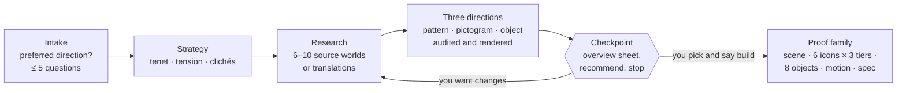

# Brand Illustration Systems: a skill for Claude and other AI agents

[](https://github.com/amenolabode/brand-illustration-skill/actions/workflows/test.yml)


An **Agent Skill** that turns Claude, or any agent that supports skills (Codex, Cursor, Gemini CLI, GitHub Copilot),
into a disciplined brand illustrator. It takes you from a brand idea to an illustration **system**: a researched
source world, a construction grammar, and a vector proof family that other designers can extend.

- **Method:** intake that asks for your preferred direction first, then strategy, source-world research, and
  translation of meaning to form (`tenet → source behaviour → visual rule → use`). Three direction options are shown
  at a checkpoint, and the full family is built only after you pick.
- **Vector-first production:** pattern tiles, per-mode construction (isometric scenes, flat pictograms with scale
  tiers, extruded editorial objects) and real animation, all generated from one set of tokens. No raster "style
  samples" passed off as a system.
- **Dependency-free tools:** an audit that catches the failures that break illustration systems, a three-direction
  overview sheet, and a renderer so the agent looks at its own work.

**Contents:** [How it works](#how-it-works) · [Install](#install) · [Use](#use) · [Example](#example-bedrock) ·
[What the audit catches](#what-the-audit-catches) · [What's inside](#whats-inside) · [Development](#development)

---

## How it works



**It asks before it assumes.** The first intake question is always *"Do you already have a direction in mind?"*:

| Your answer | What the three options become |
|---|---|
| **Yes**, e.g. "Adire textiles" or "topographic maps" | Three different **translations** of your source (pattern-led versus structure-led, flat versus extruded, literal versus abstract). Alternatives are suggested in one line, never swapped in. |
| **Partly**: a feeling, references, things to avoid | Three source worlds that satisfy your constraints |
| **No** | Three source worlds from different behaviour families (stack, weave, branch, fold, print, orbit) |

**It always stops at the checkpoint.** The three directions are presented on one overview sheet, with the same
pictogram and the same editorial object in each so the comparison is fair, plus palette, meaning chain, motion verb,
an honest risk and a recommendation. Nothing else is built until you choose.

---

## Install

### Claude Code: plugin marketplace (recommended)
```
/plugin marketplace add amenolabode/brand-illustration-skill
/plugin install brand-illustration-systems@brand-illustration-skill
```

### Claude Code: manual
```bash
git clone https://github.com/amenolabode/brand-illustration-skill.git
cp -r brand-illustration-skill/skills/brand-illustration-systems ~/.claude/skills/        # personal
# or: cp -r brand-illustration-skill/skills/brand-illustration-systems .claude/skills/    # per project
```

### Claude.ai / Claude Desktop
Run `python3 tools/package_skill.py` (or download the zip from Releases) and upload
`dist/brand-illustration-systems.zip` under **Settings → Capabilities → Skills**.

### Codex, Cursor, Gemini CLI and other agents
The skill is a plain folder with a `SKILL.md`, so copy it into your agent's skills directory:

| Agent | Personal (all projects) | Per project |
|---|---|---|
| Codex CLI | `~/.codex/skills/brand-illustration-systems` | `.codex/skills/brand-illustration-systems` |
| Cursor | `~/.cursor/skills/brand-illustration-systems` | `.cursor/skills/brand-illustration-systems` |
| Gemini CLI | `~/.gemini/skills/brand-illustration-systems` | `.gemini/skills/brand-illustration-systems` |
| Shared across agents | `~/.agents/skills/brand-illustration-systems` | `.agents/skills/` + symlinks from each agent's folder |

To use one copy for every agent in a project, keep it in `.agents/skills/` and symlink the others to it:
```bash
for a in .claude .codex .cursor; do mkdir -p $a/skills && ln -s ../../.agents/skills/brand-illustration-systems $a/skills/; done
```
`agents/openai.yaml` supplies Codex's display metadata. `.claude-plugin/` is used only by Claude Code.

The skill works best with a model that can view images, because it renders its drafts to PNG and checks them before
showing you anything.

---

## Use

Just describe the brand. The skill picks itself up from its description:

> We're Bedrock, a savings app. Small, regular contributions become a durable foundation. We need an illustration
> system for the app and marketing.

> Make our illustrations from Adire textile patterns. We're a Lagos savings cooperative.

> These are Cowrywise's illustrations. What inspired the patterns, and how would I rebuild them?

> Add a "Withdraw" icon and a "Pension" cover to our existing system (spec attached).

It works in four modes: **Design** (new system), **Reverse-engineer** (analyse a reference), **Extend** (new assets
for an existing system) and **Audit** (critique illustrations or a direction).

---

## Example: Bedrock

A fictional savings brand, *"wealth is deposited layer by layer"*, built on sedimentary stratigraphy. The whole family
is generated by [`examples/bedrock/build.mjs`](examples/bedrock/build.mjs) from one palette, one 96×36 bedding tile
and three construction functions. Open [`examples/bedrock/index.html`](examples/bedrock/index.html) for the spec page.

**Technical scene:** isometric, wireframe → volume → material. The account rests on strata plates.


**Pictograms:** flat, generated at three tiers from one definition.


**How this skill was hardened.** The first Bedrock run used an image model. The meaning chain was right, but the
output had thick stripes over every shape, one clay material across all modes, five equal-weight colours, rendered
lighting, a crack in a different place on every object, and a GIF sliced from a storyboard. That run self-certified
because it checked its prompts, not its pixels. The spec page shows v1 and v2 side by side. Those failures became the
skill's rules, its red-flag list and `system_audit.py`.

---

## What the audit catches

`python3 scripts/system_audit.py assets/*.svg`

| Level | Check |
|---|---|
| FAIL | Embedded raster images: a system proof must be vector |
| FAIL | Filters: drop shadows, blur, lighting (construction, not rendering) |
| WARN | More than one saturated hue: keep one anchor, pale faces |
| WARN | Pattern lines heavy relative to their gaps: they read as bands, not linework |
| WARN | Pattern line contrast too high against its face: ink on pastel instead of one tone step |
| WARN | Gradients, live `<text>`, no `<pattern>` at all |

---

## What's inside

```
skills/brand-illustration-systems/
├── SKILL.md                         workflow, checkpoint, chat format, red flags
├── agents/openai.yaml               Codex display metadata
├── references/
│   ├── intake.md                    the preferred-direction question, brief questions, assumptions
│   ├── direction-options.md         making three options truly different; translations; sheet spec
│   ├── research-and-translation.md  source research, scorecard, worksheet, reference analysis
│   ├── system-spec-and-validation.md  production spec, proof matrix, failure diagnoses
│   ├── production-prompts.md        vector proof route, exploration-only prompts, known failures
│   └── cowrywise-example.md         a full analysis of a real reference system
├── scripts/
│   ├── direction_sheet.py           three-option overview sheet (HTML) from JSON
│   ├── system_audit.py              system-failure audit for SVGs
│   └── render_png.py                SVG/HTML → PNG (Chrome, rsvg-convert, cairosvg, Inkscape)
└── templates/build-template.mjs     starter generator: tokens → pattern → per-mode construction → motion
examples/bedrock/                    complete worked run with spec page
evals/evals.json                     behaviour evals (intake, three options, translations, build, analysis)
tools/                               smoke test and packaging
tests/                               unit tests
```

---

## Development

```bash
python3 tools/smoke_test.py                  # runs every script the way an agent does
python3 -m unittest discover -s tests -v     # audit logic and SKILL.md contract
python3 tools/package_skill.py               # dist/brand-illustration-systems.zip
```

CI runs both on Linux, macOS and Windows. Contributions are welcome: new reference analyses, behaviour families,
audit checks and worked examples, especially from non-Western source worlds, with provenance documented.

## License

[MIT](LICENSE). Brand names in the reference analyses belong to their owners and are discussed for study only.
