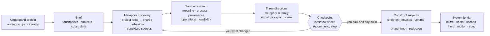

# Brand Illustration Systems: a skill for Claude and other AI agents

[](https://github.com/amenolabode/brand-illustration-skill/actions/workflows/test.yml)

An **Agent Skill** that turns Claude, or any agent that supports skills (Codex, Cursor, Gemini CLI, GitHub Copilot),
into a disciplined brand illustrator. It first understands the project, brand identity, touchpoints and subjects;
then it derives and researches metaphors from current-project evidence and draws them in whichever **rendering family** fits:
flat, character-led, expressive line, soft 3D, pattern-led, technical, a brand device or collage.

- **Method:** project-first intake, brand-guide synthesis, a **touchpoint and subject map**, closed-book metaphor
  generation and source research, then three directions. Every selected subject is built from structural guides through
  primitives, volume, clean form, brand grammar, colour/light/motion and reduction.
- **Variety by design:** the three options must use different rendering families unless you fix one, and at most one
  may be pattern-led. Lessons from reference systems are distilled as principles, never as looks to copy.
- **Vector-first production:** spots, scenes, icons and motion generated from one set of tokens and construction
  rules. 3D comes as a scene kit plus renders. No raster "style samples" passed off as a system.
- **Dependency-free tools:** an audit that catches the failures that break illustration systems, a three-direction
  overview sheet, and a renderer so the agent looks at its own work.

**Contents:** [How it works](#how-it-works) · [Install](#install) · [Use](#use) ·
[Rendering families](#rendering-families) · [What the audit catches](#what-the-audit-catches) · [What's inside](#whats-inside) · [Development](#development)

---

## How it works



**It establishes the project before style.** The first question is *“What is the brand or project, who is it for, and
what must the illustrations help people understand, feel, or do?”* It then asks only what remains open:

| Direction answer | What the three options become |
|---|---|
| **Yes, a style or reference**, e.g. “restrained flat spots” or “soft tactile 3D” | The family is fixed; three different ideas and signatures within it |
| **Yes, a source**, e.g. "Adire textiles" or "topographic maps" | Three **translations** of your source in different families. Alternatives are suggested in one line, never swapped in. |
| **Partly**: a feeling, references, things to avoid | Three families that respect your constraints |
| **No** | Three different families, at least one quiet (flat, technical) and one expressive (character, line, 3D) |

**It always stops at the checkpoint.** The three directions are presented on one overview sheet, with each
direction's signature element, construction strip, and the same product spot and scene in each so the comparison is
fair, plus palette, meaning chain, motion verb, an honest risk and a recommendation. Nothing else is built until you
choose, unless you ask it to proceed without a checkpoint.

**It knows how to draw the subject, not only style it.** The common construction spine is: subject model → composition
→ skeleton → primitive masses → volume and occlusion → clean form → brand grammar → colour/light/motion → reduction.
The same method can build a person on a bicycle, a laptop, a machine, an abstract process or a full scene, while the
selected rendering family changes what the finished result looks like.

**Examples are isolated from research.** Design mode explicitly prohibits reading repository examples, worked studies,
templates, style galleries or prior-project metaphors during metaphor generation. Candidates must be generated first
from current-project facts and carry an evidence chain: `project fact → shared behaviour → candidate source`. The
source itself is then researched. Rendering families and production scaffolds are considered only afterward.

---

## Install

### Claude Code: plugin marketplace (recommended)
```
/plugin marketplace add amenolabode/brand-illustration-skill
/plugin install brand-illustration-systems@brand-illustration-skill
```

### Claude Code: manual
```bash
git clone https://github.com/amenolabode/brand-illustration-skill.git
cp -r brand-illustration-skill/skills/brand-illustration-systems ~/.claude/skills/        # personal
# or: cp -r brand-illustration-skill/skills/brand-illustration-systems .claude/skills/    # per project
```

### Claude.ai / Claude Desktop
Run `python3 tools/package_skill.py` (or download the zip from Releases) and upload
`dist/brand-illustration-systems.zip` under **Settings → Capabilities → Skills**.

### Codex, Cursor, Gemini CLI and other agents
The skill is a plain folder with a `SKILL.md`, so copy it into your agent's skills directory:

| Agent | Personal (all projects) | Per project |
|---|---|---|
| Codex CLI | `~/.codex/skills/brand-illustration-systems` | `.codex/skills/brand-illustration-systems` |
| Cursor | `~/.cursor/skills/brand-illustration-systems` | `.cursor/skills/brand-illustration-systems` |
| Gemini CLI | `~/.gemini/skills/brand-illustration-systems` | `.gemini/skills/brand-illustration-systems` |
| Shared across agents | `~/.agents/skills/brand-illustration-systems` | `.agents/skills/` + symlinks from each agent's folder |

To use one copy for every agent in a project, keep it in `.agents/skills/` and symlink the others to it:
```bash
for a in .claude .codex .cursor; do mkdir -p $a/skills && ln -s ../../.agents/skills/brand-illustration-systems $a/skills/; done
```
`agents/openai.yaml` supplies Codex's display metadata. `.claude-plugin/` is used only by Claude Code.

The skill works best with a model that can view images, because it renders its drafts to PNG and checks them before
showing you anything.

---

## Use

Just describe the brand. The skill picks itself up from its description:

> We're a savings app. Small, regular contributions become a durable foundation. We need an illustration
> system for the app and marketing.

> Make our illustrations from Adire textile patterns. We're a Lagos savings cooperative.

> We're a bill-splitting app. Make the illustrations flat, friendly and useful at product size.

> These illustrations use security-print patterns. What inspired them, and how would I rebuild the system?

> Recreate this illustration, explain how you did it, then apply the direction to a laptop.

> Add a "Withdraw" icon and a "Pension" cover to our existing system (spec attached).

It works in five modes: **Design** (new system), **Reverse-engineer** (analyse a reference system), **Transfer**
(recreate one illustration and apply its direction to a new subject), **Extend** (new assets for an existing system)
and **Audit** (critique illustrations or a direction).

**Transfer** breaks a reference into seven layers (field, large shapes, palette roles, pattern owners, depth, reward
objects, rendering), then rebuilds it as vector and scores the rebuild against the reference with `match_score.py`,
measuring what doesn't match (ring centres, stripe periods, dot lattices, contour tapers) until the misses are craft
rather than missing rules. In the study behind this mode, the score went from 76.6% to 90.3% on figure pixels, and
every jump came from a rule the first description didn't have. The rules then become a new project-local kit generated
from the supplied reference, and three compositions of the new subject are built with it. Each element's
*role* is mapped onto the new subject. The striped jumper's role (the largest patterned curve) might go to a laptop's cable loop, and the
reference's props are replaced with props from the laptop's world rather than copied. Before the extracted kit is
applied, the laptop is independently constructed from its axes, hinge, screen/deck planes, silhouette and occlusion.
A close recreation is treated as a study, never a deliverable. References contribute execution qualities; they do not
determine the new project's metaphor, composition, palette or content.

---

## Rendering families

| Family | Looks like | Studied in |
|---|---|---|
| Flat spot | Simple geometric shapes, one accent, product-sized | Product states and compact explanatory moments |
| Character-led | A cast with fixed proportions and personalities | Habit, encouragement, community and emotion |
| Expressive line | Hand-drawn line, imperfect and human | Editorial storytelling and human viewpoint |
| Soft 3D | Rendered materials, light, camera | Tactile feature explanation and campaigns |
| Pattern-led surface | Objects carry a meaningful source-world pattern | Security print, textiles, maps and material processes |
| Technical | Grids, notation, isometric construction | Expert tools, processes and data abstraction |
| Brand device | One recurring shape or object carries the story | Motion-heavy suites with strong existing geometry |
| Collage | Mixed photo, texture and drawing | Campaign, editorial and social work |

Each has construction rules, the touchpoints it suits, how it reduces to small sizes and how it fails
(`references/style-families.md`). Families can pair by tier, e.g. flat spots in product and 3D heroes in marketing.

## What the audit catches

`python3 scripts/system_audit.py --family flat|editorial|character|line|3d|pattern|technical|device|collage assets/*.svg`

The rules follow the family: a filter is a failure in a flat spot but fine in a 3D or collage asset.

| Family | Rasters | Filters | Gradients | Saturated hues |
|---|---|---|---|---|
| flat, technical, device, pattern | FAIL | FAIL | WARN | 1 |
| editorial (bold flat figurative) | FAIL | FAIL | one allowed, more WARN | 4 |
| character | FAIL | WARN | WARN | 2 |
| line | WARN | WARN | allowed | 2 |
| 3d / collage | allowed | allowed | allowed | 2 / 3 |

Every family: live `<text>` warns, and any `<pattern>` whose lines read as bands or contrast too strongly warns.
Only the pattern family warns when there is no pattern.

Two more checks:

- `render_png.py --silhouette` renders every shape black with the background removed (the large-shape test), and
  `--grey` renders it in greyscale.
- `raster_check.py image.png` checks image-model exploration for what flat styles depend on. It FAILs a background
  with a glow, vignette or gradient, WARNs one that is noisy rather than one solid fill, and lists the dominant
  colours. It also WARNs when the PNG carries a non-sRGB colour profile, because hexes sampled from it are wrong.
- `match_score.py recreation.svg reference.png` scores a vector rebuild against its reference: agreement, IoU per
  colour, the worst regions and a diff image.

---

## What's inside

```
skills/brand-illustration-systems/
├── SKILL.md                         workflow, checkpoint, chat format, red flags
├── agents/openai.yaml               Codex display metadata
├── references/
│   ├── intake.md                    project-first brief, guidelines, subjects, direction, assumptions
│   ├── constructive-illustration.md universal subject construction + human-on-bike worked example
│   ├── touchpoints.md               inventory, tiers, emotional temperature, proof moments
│   ├── style-families.md            the eight rendering families
│   ├── reference-systems.md         anonymised system patterns and transferable lessons
│   ├── direction-options.md         making three options truly different; sheet spec
│   ├── research-and-translation.md  clean-slate metaphor generation, source research and translation
│   ├── reference-transfer.md        recreate one illustration and apply it to a new subject
│   ├── system-spec-and-validation.md  production spec, proof matrix, failure diagnoses
│   ├── production-prompts.md        production route per family, exploration-only prompts, known failures
├── scripts/
│   ├── direction_sheet.py           three-option overview sheet (HTML) from JSON
│   ├── system_audit.py              family-aware audit for SVGs
│   ├── raster_check.py              flat-field and palette check for raster exploration
│   ├── render_png.py                SVG/HTML → PNG (Chrome, rsvg-convert, cairosvg, Inkscape); silhouette, grey
│   └── match_score.py               score a vector recreation against its reference (Transfer)
examples/layered-savings/            development-only validation fixture; excluded from the packaged skill
evals/evals.json                     behaviour evals (intake, varied families, fixed family, translations, build, analysis, transfer)
tools/                               smoke test and packaging
tests/                               unit tests
```

---

## Development

```bash
python3 tools/smoke_test.py                  # runs every script the way an agent does
python3 -m unittest discover -s tests -v     # audit logic and SKILL.md contract
python3 tools/package_skill.py               # dist/brand-illustration-systems.zip
```

CI runs on Linux, macOS and Windows. Repository examples are development fixtures and are not included in the packaged
skill or read during Design-mode research.

## License

[MIT](LICENSE).
